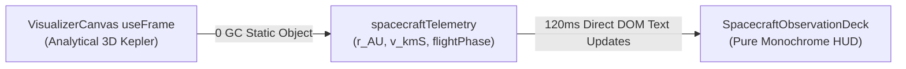

# Cinematic Spacecraft Canopy & Monochrome Observation Deck

This skill defines the architectural formulation, optical physics, and strict minimalist art direction for the spacecraft observation canopy in **Cyberpulse 3D**. It directly addresses the user mandate:
> *"suy nghĩ thật kỹ làm cho thật điện ảnh, giao diện vẫn trắng đen, không thêm màu khác, ít chữ thôi... càng đơn giản hiệu quả càng tốt"*

---

## 1. Cinematic Art Direction & Philosophical Precedents

True deep-space cinema (*2001: A Space Odyssey*, *Interstellar*, *Solaris*, *Ad Astra*) achieves grandeur not through noisy cockpit dashboards, blinking neon dials, or paragraphs of technical text, but through **monolithic architectural framing and contemplative silence**.

```
    +-------------------------------------------------------------------+
    | [ HULL BULKHEAD ]                                                 |
    |\                                                                 /|
    | \                                                               / |
    |  \                                                             /  |
    |   +-----------------------------------------------------------+   |
    |   |                                                           |   |
    |   |                                                           |   |
    |   |                 MONOLITHIC QUARTZ APERTURE                |   |
    |   |                                                           |   |
    |   |                        +  (Sol 0,0,0)                     |   |
    |   |                                                           |   |
    |   |                                                           |   |
    |   +-----------------------------------------------------------+   |
    |  /                                                             \  |
    | /                                                               \ |
    |/ [ WHISPER TELEMETRY: 14.6 AU // 15.8 KM/S ]                     \|
    +-------------------------------------------------------------------+
```

### 1.1. The Three Inviolable Laws

1. **The Law of Pure Monochrome (Luật Đơn Sắc Tuyệt Đối):**
   - **Zero colored pixels allowed.** No cyan (`#00f3ff`), no amber (`#ffaa00`), no green, no red, no RGB hue.
   - The palette is strictly chiaroscuro:
     - Void Black: `#050507`
     - Titanium Bulkhead: `#0a0c12` to `#161922`
     - Machined Steel Accent: `#222634`
     - Hairline Bevel Reflection: `#ffffff` at variable opacities (`15%` to `60%`)
     - Whispering Monospace Type: `#666677` and `#cccccc`
2. **The Law of Micro-Text / Negative Space (Luật Tối Giản Chữ & Chống Rác Giao Diện):**
   - **No walls of text.** No paragraphs of specs (`SPEC: TI-6AL-4V...`, `METEOROID SHIELD...`, `CABIN PRESSURE...`).
   - The physical structure of the window frame tells $95\%$ of the story.
   - Text is reduced to a single, understated technical whisper:
     $$\text{HUD Readout} \le 12 \text{ words total across the entire screen}$$
3. **The Law of Panoramic Unobstructed Core (Quy Tắc Thoáng Đãng Trung Tâm):**
   - The window aperture must leave $\ge 88\%$ of the screen completely clear.
   - Central Sol at $(0, 0, 0)$, planetary orbital rings, the Kepler Harmonograph, and the Kuiper Belt are framed like an IMAX astronomical canvas without a single pixel of obstruction.

---

## 2. Architectural Structural Anatomy

### 2.1. Monolithic Chamfered Canopy (Khung Cửa Đài Quan Sát)
The observation frame mimics an ultra-wide panoramic cupola bridge portal:
- **Top Canopy Brow:** A sleek, solid titanium bulkhead framing the upper edge of the screen, finished with a razor-thin 1px silver highlight line where light grazes the beveled metal edge.
- **Ventral Observation Sill:** A solid, low-profile bridge railing at the bottom, perfectly positioned above the player deck.
- **4 Corner Structural Mullions ($45^\circ$ Chamfer):** Strong diagonal structural trusses extending smoothly inward from the screen corners, giving unmistakable physical presence and perspective depth.
- **Bevel Chamfer Lighting:**
  - A crisp 1.5px silver stroke (`rgba(255, 255, 255, 0.40)`) tracing the inner perimeter of the window aperture.
  - A secondary hairline groove (`rgba(255, 255, 255, 0.10)`) offset inside the metal plate.
  - Symmetrical machined rivets (tiny 3px metallic circles with white specular cores) along the structural rib seams.

### 2.2. Quartz Glass Optics in Pure Chiaroscuro
Multi-ply fused quartz glass in deep space has physical presence without requiring fake blue or green tints:
- **Perimeter Radial Falloff:** A subtle vignette darkening the extreme corners:
  $$\text{Vignette} = \text{radial-gradient}(\text{ellipse } 90\% \times 84\%, \text{transparent } 68\%, \text{rgba}(3, 4, 8, 0.6) \text{ } 88\%, \text{rgba}(0, 0, 0, 0.95) \text{ } 100\%)$$
- **Anti-Reflective Specular Glare:** A faint $45^\circ$ diagonal monochrome sheen across one corner (`opacity-25` to `35%`), simulating starlight grazing the polished glass surface.
- **Optical Graticule:** A delicate, sub-millimeter white crosshair (`+`) at the center of the viewport with hairline alignment brackets (`┌ ┐ └ ┘`), evocative of NASA Apollo and Hubble optical sighting targets.

---

## 3. Dynamic Real-Time Synchronization (0 GC / 120 FPS)

The canopy HUD connects directly to the ship's Keplerian orbital trajectory:
- Heliocentric distance $r(t) \in [11.0, 18.2]\text{ AU}$.
- Orbital velocity $v(t) \in [11.8, 18.2]\text{ km/s}$.
- Attitude banking tilt $\beta(t) = 0.038 \times \cos(M(t))$.



Telemetry is displayed in a single, ultra-clean horizontal status strip:
```
[ 14.6 AU // 15.8 KM/S // ECLIPTIC CRUISE ]
```
Zero React re-renders, zero memory allocations per frame, guaranteed locked 120 FPS.

---

## 4. Quality Checklist & Anti-Arcade Filter

| Verification Check | Standard | Pass / Fail Criteria |
| :--- | :--- | :--- |
| **Color Purity** | Strict Black & White | Fails if any pixel contains non-monochrome hue (no cyan, amber, red, blue, green). |
| **Text Density** | Less than 15 words total | Fails if walls of text, multiple paragraphs, or redundant diagnostic tags exist. |
| **Central Visibility** | $\ge 88\%$ viewport open | Fails if struts or HUD elements occlude Sol or inner planetary orbits. |
| **Visual Immersion** | Cinematic window presence | Must instantly convey standing on an observation bridge looking into deep space. |
| **Mode Exclusivity** | Active only in Spacecraft mode | Completely invisible (`opacity: 0, pointer-events: none`) in Vista and Orbit modes. |
