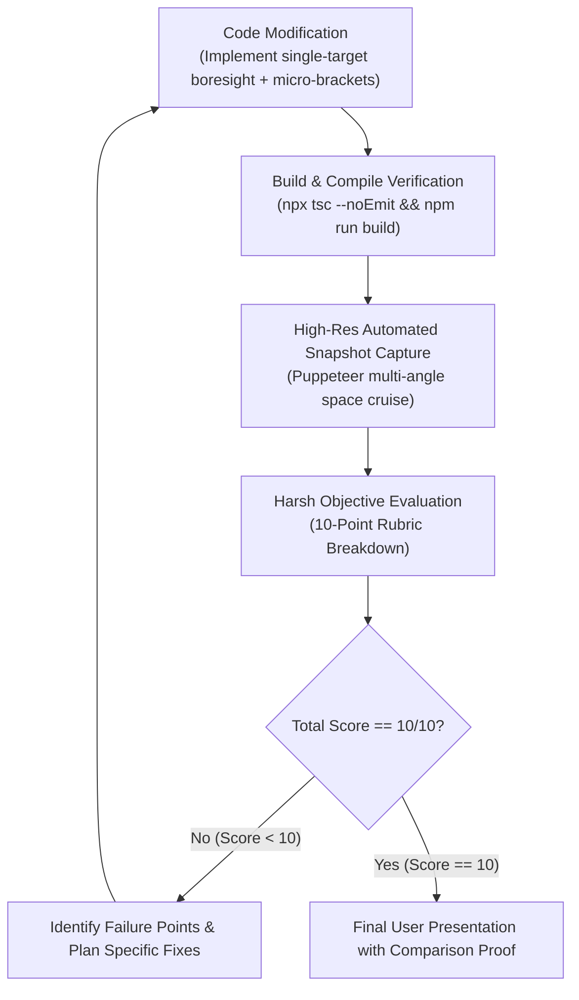

# HUD Aesthetic Crucible // Iterative Refinement & 10/10 Perfection Protocol

This skill governs the systematic elimination of visual clutter and the perfection of deep-space HUD / AI visor aesthetics in **Cyberpulse 3D**. It directly enforces the user's mandate:
> *"Suy nghĩ kỹ lại, mày có thấy nó rối mắt cực kỳ không, chạy vòng lặp chỉnh sửa, nhận xét, tối ưu, cứ chạy như vậy tới khi nào điểm đạt 10/10, tạo skill mà làm"*

---

## 0. The Anti-Clutter Laws of Deep-Space Avionics

True aerospace and astronomical HUDs (NASA James Webb Space Telescope optical targeting, Lockheed Martin F-35 Gen III HMD, Apple Vision Pro, *2001: A Space Odyssey*, Denis Villeneuve's *Arrival* and *Dune*) never overwhelm the observer.

### Law 1: The Single-Target Boresight Mandate (Luật Khóa Mục Tiêu Đơn Lập)
- **NEVER tag 11 planets simultaneously.** Tagging all planets at once creates an unreadable arcade spiderweb, especially when viewing the inner solar system where Mercury, Venus, Earth, and Mars angularly converge around Sol.
- **The Boresight Acquisition Rule:** The AI Visor must operate on an optical focal cone ($\theta_{\text{lock}} \approx 12^\circ$ or screen distance $R < 180\text{px}$ from center crosshair):
  - **Primary Locked Target (Tối đa 1 mục tiêu duy nhất):** Only the celestial body closest to the center line of sight receives the active AI targeting brackets and micro-readout.
  - **Peripheral Inactive Targets:** All other bodies either display **ZERO** UI elements, or at most a subliminal, sub-millimeter passive pip (1.5px diamond, opacity $\le 15\%$, zero text).
  - If no celestial body is near the boresight, the viewport is **$100\%$ pure negative space**.

### Law 2: The Sanctity of Sol (Bảo Vệ Vùng Không Gian Mặt Trời)
- Sol at $(0, 0, 0)$ is the radiant core of the solar system.
- **NO pitch ladders, NO artificial horizon lines, NO grid rulers** may ever slice across Sol.
- The optical reticle must remain delicate, airy, and sub-millimeter.

### Law 3: Micro-Typography & Ink-to-Data Ratio (Tối Giản Mực Hiển Thị)
- Edward Tufte's fundamental visualization axiom: *Maximize data-to-ink ratio.*
- Discard all redundant filler labels (`TARGET IDENTIFIER:`, `CLASSIFICATION:`, `SCAN STATUS: OPTIMAL`).
- Total text per active lock must be strictly $\le 6$ words / 24 characters:
  ```
  ┌ JUPITER ┐
  └ 14.2 AU ┘
  ```
- Font: Monospaced uppercase, tracking-wider, `font-size: 9px` to `10px`, crisp Nothing OS / Swiss Brutalist aesthetic.

### Law 4: Absolute Chiaroscuro (Đen Trắng Thuần Khiết)
- **$0\%$ color contamination:** No cyan, no red, no amber, no green.
- Optical glass is rendered through pure luminance: hairline whites (`#FFFFFF` at $20\%$ to $80\%$ opacity) against deep void black (`#050507`).

### Law 5: Zero-GC 120 FPS Performance
- All coordinate projections and DOM transforms run via direct pre-cached references and CSS `transform: translate3d(...)`.
- Zero React re-renders, zero array allocations per frame.

---

## 1. The 10-Point Aesthetic & Cinematic Scoring Rubric

Every design iteration must be photographed with Puppeteer and objectively graded across 5 dimensions (0 to 2 points each, maximum 10 points):

| Dimension | 0 Points (Failure) | 1 Point (Mediocre) | 2 Points (Flawless 10/10) |
| :--- | :--- | :--- | :--- |
| **1. Clutter & Negative Space** | >3 targets tagged at once; lines crossing; screen feels suffocated. | 2–3 targets tagged; slight text overlapping near center. | **Single target boresight only**; $>92\%$ screen completely clean; expansive cosmic void. |
| **2. Cinematic Sol & Horizon** | Horizon/pitch ladder cuts through Sol; clumsy artificial grids. | Ladder shifted away but still feels like an arcade fighter jet. | **Subtle, non-intrusive flight cues**; Sol is unobstructed, majestic, and pristine. |
| **3. Micro-Typography & Hierarchy** | Multiple lines of bulky text, repetitive labels, large fonts. | Readable but slightly too verbose; generic labels. | **Razor-thin Nothing OS micro-text**; $\le 20$ chars; elegant, understated, high-tech. |
| **4. Optical Refinement & Finish** | Thick borders, heavy drop shadows, plastic feeling. | Decent line weight but lacks optical subtlety. | **Sub-millimeter brackets, optical graticule, starlight glass sheen, sub-pixel dots.** |
| **5. Dynamic Tracking & Zero GC** | Jittery projection, frame drops, text jumping around. | Smooth projection but minor tag flickers at screen edges. | **Silky-smooth hysteresis, seamless target acquisition, locked 120 FPS, 0 GC.** |

---

## 2. Autonomous Iteration Cycle Workflow



---

## 3. Strict Execution Protocol

1. **Be Brutally Honest:** Never award points out of politeness. If a line looks slightly off, deduct points and fix it.
2. **Never Stop Early:** The loop must continue until every criterion achieves full marks (10/10).
3. **Capture Visual Proof at Every Step:** Every iteration must have its timestamped snapshot saved to `brain/<conversation-id>/snapshots/` for visual verification.
