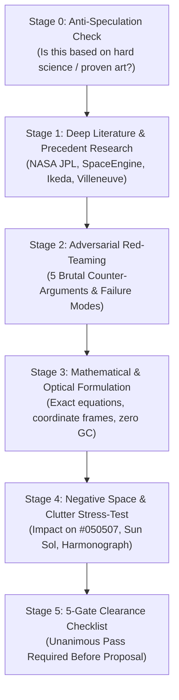

# Rigorous Concept Crucible // Deep-Research & Anti-Speculation Protocol

This skill governs the systematic discovery, validation, and stress-testing of all new visual, physical, and audio-reactive concepts for **Cyberpulse 3D**. It establishes an uncompromising engineering and artistic filter: **No concept may ever be proposed or implemented based on casual speculation, subjective guesswork, or superficial novelty.**

Every proposal must undergo an exhaustive, multi-stage examination process running through deep astrophysical literature, real-world art precedents, mathematical formulation, and adversarial red-teaming.

---

## 0. The Anti-Speculation Mandate (Cấm Đề Xuất Suy Đoán)

### A. The 5 Forbidden Speculative Patterns (Các Mẫu Suy Đoán Bị Nghiêm Cấm)
1. **"Tôi nghĩ làm cái này sẽ đẹp" (Subjective Guessing):** Proposing an effect simply because it sounds cool without scientific or artistic proof of fit.
2. **"Thêm tia / vệt / màu cho rực rỡ" (Neon/Clutter Trap):** Adding colored glow bars, neon beams, or chromatic streaks that violate the Swiss Brutalist / Chiaroscuro aesthetic and contaminate `#050507`.
3. **"Vẽ thêm các vòng / đường đo đạc nhân tạo" (Arcade Clutter):** Adding concentric radar rings, ruler lines, or coordinate grids that turn the celestial space into a noisy arcade HUD.
4. **"Mô hình hóa hình học thiếu tính toán phép chiếu" (Projection Blindness):** Assuming a 3D curve or spline will look straight in perspective, leading to warped "banana" or distorted shapes (the exact root cause of the failed Sword Slash).
5. **"Bỏ qua phản biện ngược" (Confirmation Bias):** Only listing benefits while ignoring how the feature could fail, distort, or distract from existing core elements.

---

## 1. Case Studies: Learning from Codebase History

To prevent past mistakes from ever repeating, every research cycle must measure new concepts against these historical precedents:

| Concept | Outcome | Root Cause of Success / Failure | Lesson Learned |
| :--- | :--- | :--- | :--- |
| **Cosmic Sword Slash** | **REJECTED & DELETED** | Proposed as a spacetime tear; spherical bezier spline projected as a bent banana curve; Gaussian additive glow turned into a fat neon lightsaber plastered across the void. | Never create artificial glowing streaks in the sky. If an element cannot remain razor-sharp and non-intrusive from all perspective angles, it fails immediately. |
| **Parker Solar Spiral & Precession Clock** | **REJECTED & DELETED** | Over-engineered mathematical curves drawn directly around Sol, creating "orbital spaghetti" that choked the central star. | Sol must remain pure, majestic, and uncluttered. Never wrap dense lines around the stellar core. |
| **Milky Way Backdrop** | **HIGHLY PRAISED & KEPT** | Astronomical tilt ($60.19^\circ$), Sagittarius A* core, Great Rift dust extinction, pre-baked at startup into $2048 \times 1024$ texture, locked 120 FPS, scotopic silver `#D4D8E2`, max opacity $14\%$. | Background elements must be subtle whispers in the dark—visible only when looking into deep space, never competing with foreground celestial bodies. |
| **Astrophysical Space Lighting** | **HIGHLY PRAISED & KEPT** | ACES Filmic tone mapping, forward Mie scattering crescents, Earthshine, analytical eclipse shadows (0 shadow maps), scotopic ambient `#C8D6E5`. | Physical truth and optical restraint always triumph over synthetic arcade effects. Real physics looks more futuristic than fake sci-fi. |

---

## 2. The 30-Minute Multi-Stage Crucible Protocol

Before any new idea is presented to the user, the agent must execute the following sequential stages. **Take time. Do not rush.** A thorough 30-minute investigation prevents weeks of wasted engineering and aesthetic frustration.



---

### Stage 1: Deep Literature & Precedent Research (Nghiên cứu Tiền lệ & Khoa học Thực tế)
Every concept must be anchored in at least two authoritative domains:
1. **Astrophysics & Planetary Science:**
   - NASA JPL / ESA / NASA Solar Dynamics Observatory (SDO) / Cassini / New Horizons ephemerides and observational data.
   - Genuine physical phenomena (e.g. magnetohydrodynamics, radiative transfer, Rayleigh/Mie scattering, gravitational lensing, tidal heating, plasma bow shocks).
2. **High-Art Visual & Architectural Precedents:**
   - **Ryoji Ikeda:** Clinical monochrome data minimalism, binary pulses, sub-millimeter line precision.
   - **Nonotak Studio:** Architectural light geometries, synchronized chiaroscuro strobes, extreme dark contrast.
   - **Denis Villeneuve & Greig Fraser (*Dune*, *Blade Runner 2049*):** Monumental scale, harsh single-key directional lighting, uncompromised negative space.
   - **SpaceEngine / Elite Dangerous:** Photorealistic astronomical simulation, analytical shaders, zero arcade clutter.

---

### Stage 2: Adversarial Red-Teaming (Giai đoạn Phản biện Đối chứng Khắc nghiệt)
The researcher must act as the feature's harshest critic and answer the **5 Brutal Questions**:

1. **The Gaudy/Cheap Test:** What makes this feature at risk of looking like a cheap mobile game effect or a generic synthwave neon cliche?
2. **The Clutter & Negative Space Test:** Does this feature add lines, polygons, or glow that steal attention from Sol, the planets, or the pristine `#050507` void?
3. **The Perspective & Projection Distortion Test:** How will this geometry behave when the camera orbits, pitches, or zooms from $r = 0.5$ to $r = 45.0$? Could perspective projection warp a curve into a banana or cause pixel shimmering / moiré?
4. **The Collision & Interference Test:** Does this overlap with existing features (Relativistic Geodesic Horizon, Kepler Harmonograph, Interstellar Bolide, Milky Way)?
5. **The Long-Term Fatigue Test:** Will the user grow tired or annoyed by this effect after listening to 5 songs in a row?

> If any question reveals an unresolvable aesthetic compromise, the concept is **IMMEDIATELY TERMINATED**. Do not attempt to "patch" a fundamentally flawed idea.

---

### Stage 3: Mathematical & Technical Formulation (Xây dựng Mô hình Toán học)
Before proposing, the complete mathematical formulation must be derived:
1. **Coordinate Frame:** Ecliptic heliocentric coordinates, planetocentric coordinates, or screen-space camera plane.
2. **Analytical Equations:** Closed-form mathematical formulas (no numeric integration loops, no expensive raymarching).
3. **GPU Data Layout:**
   - Number of vertices and primitives.
   - Exact GLSL vertex and fragment shader structures.
   - Uniforms and attribute bindings.
4. **Zero-GC Performance Guarantee:**
   - 100% pre-allocated typed arrays (`Float32Array`) at startup.
   - Reusable static module vectors for all runtime calculations.
   - Exact target: **0 bytes allocated per frame in `useFrame`** at locked **120 FPS**.

---

### Stage 4: Negative Space & Cleanliness Verification
- **The #050507 Test:** The cosmic background void must remain pitch black. No non-directional fog or ambient milky wash.
- **The Sun Integrity Test:** Sol at `(0,0,0)` must remain majestic, spherical, and uncluttered.
- **The Hierarchy Test:** Primary celestial bodies (Sun, Earth, Saturn, Jupiter) > Natural astronomical backdrops (Milky Way, Kuiper belt) > Audio-reactive phenomena (CME blast, Bolide). Any new feature must occupy a strictly subordinate visual tier.

---

### Stage 5: The 5-Gate Clearance Checklist (Bảng Tiêu chí Xuất xưởng)

An idea may ONLY be presented to the user if it receives a checkmark on all 5 gates:

- [ ] **Gate 1 (Scientific & Artistic Grounding):** Derived from verified astrophysics or documented avant-garde visual art; 0% speculation or guesswork.
- [ ] **Gate 2 (Negative Space & Zero Clutter):** Does not obstruct Sol or planets; preserves deep void `#050507`.
- [ ] **Gate 3 (Adversarial Red-Team Passed):** All 5 brutal failure modes analyzed, addressed, and neutralized.
- [ ] **Gate 4 (120 FPS / 0 GC Guarantee):** All math runs GPU-side or via pre-allocated module vectors; 0 allocations in `useFrame`.
- [ ] **Gate 5 (Concise Proposal Structure):** Structured with clear Problem Statement, Physical Precedent, Mathematical Model, and Expected Visual Result.

---

## 3. Proposal Presentation Template

When presenting a vetted concept to the user, strictly use this markdown structure:

```markdown
### [Tên Ý Tưởng / Feature Name]

1. **Hiện tượng Vật lý & Tiền lệ Nghệ thuật (Grounded Origin):**
   - Nguồn gốc thiên văn: (NASA, ESA, hiện tượng vật lý thực)
   - Tiền lệ nghệ thuật: (Ryoji Ikeda / Nonotak / Denis Villeneuve / SpaceEngine)

2. **Vấn đề giải quyết & Giá trị thị giác (Why It Matters):**
   - Tại sao tính năng này nâng tầm trải nghiệm mà KHÔNG làm rối mắt?

3. **Mô hình Toán học & Kỹ thuật Shader (Technical Formulation):**
   - Hệ tọa độ & Công thức: ...
   - Hiệu năng: 0 GC, 120 FPS, số draw call = 0 hoặc 1.

4. **Kết quả Phản biện Đối chứng (Red-Team Audit):**
   - Đã lường trước rủi ro gì? (ví dụ: góc nhìn xiên, biến dạng phối cảnh, nguy cơ quá sáng)
   - Giải pháp triệt tiêu rủi ro đó: ...
```
