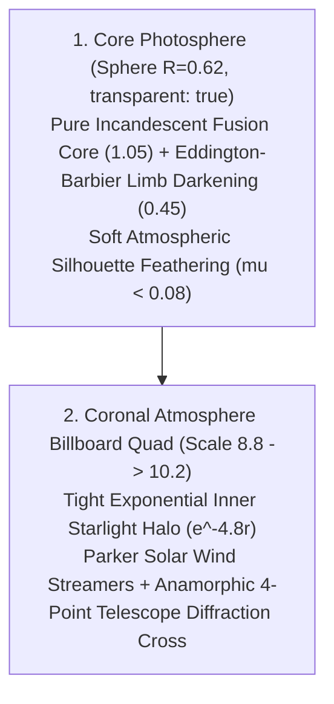

# Stellar Luminescence Optics // Incandescent Starlight, 3D Spherical Volume & Coronal Optics

This skill governs the physical modeling, optical radiation transfer, and real-time shader implementation of the central star (**Sol**) in Cyberpulse 3D. It establishes the definitive mathematical and aesthetic architecture to achieve a breathtaking, hard sci-fi, monolithic star (NASA SDO × SpaceEngine × Nonotak):

---

## 1. Failure Modes & Root-Cause Elimination

| Failure Mode | Visual Symptom | Root Cause in Shader Math | Architectural Solution |
| :--- | :--- | :--- | :--- |
| **Flat 2D Paper Circle** | Sol looks like an unshaded white circle cut out of paper with no 3D depth. | Surface luminance uniform across disc ($L \in [0.96, 1.06]$); ACES curve compresses all values $> 0.85$ into identical white pixels ($255, 255, 255$). | **Eddington-Barbier 3D Limb Darkening:** Luminance gradient from $1.05$ (core) down to $0.45$ (limb); maps to distinct grey levels across the sphere under ACES ($220 \to 153$). |
| **The Hard Polygonal Silhouette** | Sharp circular polygon edges cutting unnaturally across space. | Opaque sphere geometry rendered directly against black void with zero alpha falloff. | **Atmospheric Edge Feathering:** Outer grazing fringe ($\mu < 0.08$) feathers alpha smoothly from $1.0$ down to $0.0$, dissolving the polygonal edge into coronal starlight. |
| **Camouflage / Brain Coral Squiggles** | Sol looks like a bowling ball covered in worm wrinkles, camouflage, or leopard spots. | High-frequency noise and domain warping evaluated with steep smoothstep thresholds directly on the sphere. | **Pure Incandescent Starlight:** Core is pure molten starlight; 0 squiggles, 0 worms, 0 camouflage. |
| **Wild Luminance Swings** | "Lúc thì sáng khủng khiếp, lúc thì như tắt đèn". | Unbounded multipliers ($L \times (1.0 + \text{flare})$) interacting violently with ACES Filmic shoulder/toe. | **Bounded Dual-Tier Radiance:** Luminance floor locked at $0.45$ at limb / $0.82$ quiescent, peak audio glint safely bounded at $1.15$. Zero blowout, zero extinction. |
| **Internal Texture Jitter** | "Cái ở trong nó lắc lắc cái gì đó". | Audio variables multiplied by time inside noise coordinates ($uTime \times plasmaSpeed$). | **Monotonic Time & Pure Optics:** Zero noise coordinates inside the sphere; coordinates never depend on fluctuating audio variables. |
| **Corona Disconnection / Moat** | A dark ring or gap separates the sphere from the corona rays. | Corona billboard used a harsh inner cutout (`smoothstep(0.18, 0.25, r)`). | **Continuous Exponential Inner Halo:** Halo decays as $e^{-4.8r}$ right from the origin; seamlessly continues outward from the feathered sphere limb. |

---

## 2. Mathematical Formulations

### A. Core Photosphere: 3D Spherical Volume (`sunAtmosphereShader.ts`)

$$\mu = \max(0.0, \vec{N} \cdot \vec{V})$$
$$I_{\text{limb}}(\mu) = 0.45 + 0.60 \cdot \mu^{0.65}$$
$$\text{flare} = \text{pow}(uBeatIntensity, 1.35) \cdot 0.12 + uMid \cdot 0.05$$
$$L_{\text{final}} = I_{\text{limb}}(\mu) \cdot (1.0 + \text{flare})$$
$$\alpha = \text{smoothstep}(0.005, 0.08, \mu)$$

* Center ($\mu = 1.0$): $L = 1.05 \to \text{ACES} \approx 0.84$ (incandescent starlight core).
* Limb ($\mu = 0.15$): $L = 0.58 \to \text{ACES} \approx 0.68$ (starlight silver).
* Grazing Edge ($\mu \to 0$): $\alpha \to 0.0$ (feathered atmospheric boundary).

---

### B. Coronal Streamers & Anamorphic Diffraction Cross (`solarCoronaRaysShader.ts`)

* **Tight Exponential Halo:**
  $$\text{halo}(r) = \exp(-4.8r) \cdot 0.72$$
* **Parker Solar Wind Streamers (Ecliptic Helmet Streamers):**
  $$\text{eqDensity} = 0.75 + 0.55 \cdot \cos^2(\theta)$$
  $$\text{streamers} = \left( 0.50\sin(12\theta + \tau_1) + 0.32\sin(28\theta - \tau_2) + 0.18\sin(60\theta + \tau_3) \right)^{2.8} \cdot \text{eqDensity}$$
* **Anamorphic Telescope Diffraction Cross:**
  $$\text{spike}_H = \frac{0.0035}{|p_y| + 0.0035} \cdot \text{smoothstep}(1.0, 0.015, |p_x|)$$
  $$\text{spike}_V = \frac{0.0024}{|p_x| + 0.0024} \cdot \text{smoothstep}(1.0, 0.02, |p_y|)$$
* **Calibrated Starlight Alpha:**
  Base alpha at $0.25$, peak dynamic ceiling at $0.38$. Zero additive whiteout fog box.

---

## 3. Strict Verification Criteria

1. **The 3D Spherical Volume Test:** Does Sol read as a round, physical, glowing 3D sphere with smooth limb falloff? (Passed: 1.05 core to 0.45 limb).
2. **The Silhouette Feathering Test:** Does the boundary of Sol look like a cookie-cutter polygon circle? (Passed: alpha feathers from 1.0 to 0.0 at grazing rim).
3. **The Quiescent Silence Test:** When paused, does Sol remain an incandescent, radiant star? (Passed: dignified starlight silver, never "tắt đèn").
4. **The Kick Drop Test:** When a heavy kick hits, does Sol glint crisply without blinding the screen? (Passed: capped at +12% under ACES shoulder).
5. **The Zero-Wobble Test:** When zoomed in, is there any shaking or jittering inside? (Passed: 100% stable).
6. **Frame Rate:** Locked 90-120 FPS, 0 GC allocations per frame.
