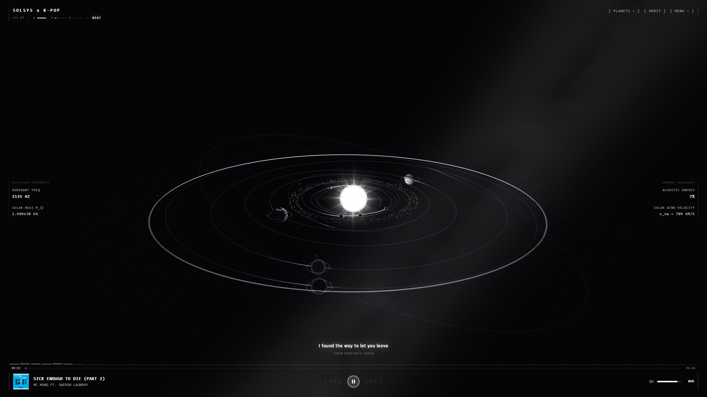
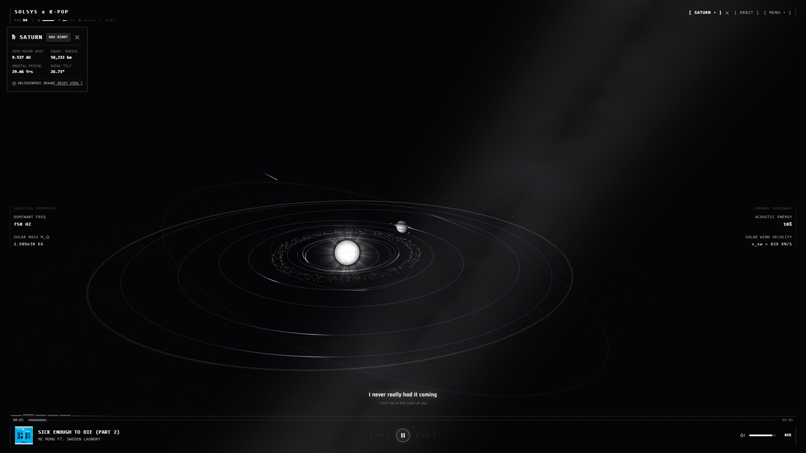
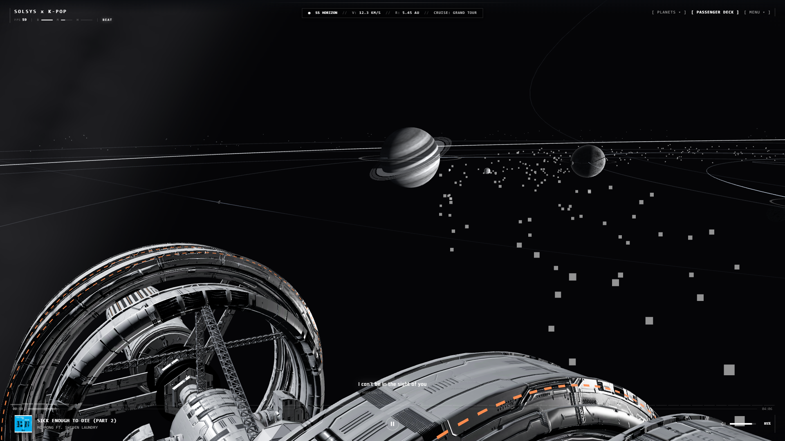
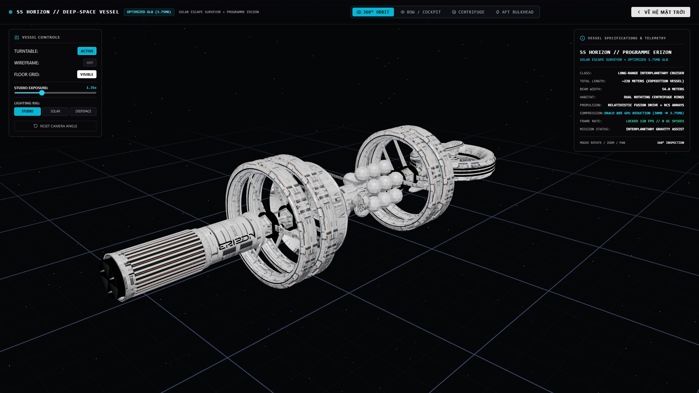

# SOLSYS x K-POP // 3D HELIOCENTRIC AUDIO VISUALIZER

<p align="center">
  
</p>

<p align="center">
  <strong>An avant-garde, physical-mathematical 3D Heliocentric Audio Visualizer & Interplanetary Exploration Suite built for K-Pop, K-HipHop, Melodic Rap, and Electronic Music.</strong>
</p>

<p align="center">
  
  
  
  
  
  
  
</p>

---

## 🌌 Overview

**SOLSYS x K-POP** combines astrophysical heliocentric dynamics (**NASA JPL DE440** ephemerides), custom GLSL atmospheric limb-scattering shaders, **ACES Filmic HDR tone mapping**, real-time **Windows System Media Transport Controls (SMTC)** Spotify audio bridging, synchronized multi-line karaoke lyrics, and the hard sci-fi interplanetary cruiser **SS Horizon** running at a locked **120 FPS** with **0 garbage collection allocations** per frame.

Specially calibrated to handle the high master loudness (-9.5 dB RMS) and melodic vocal transitions of modern Korean music—from melodic rap (MC Mong, Epik High) and ballads to high-tempo K-Pop choreographies and EDM drops.

---

## 🏛️ Architectural Showcase

| Mode | Visual Vista | Architectural Details |
| :--- | :--- | :--- |
| **01. HELIOCENTRIC ORRERY** |  | **Calibrated Default Orbit Vista** ($D = 35.5, \text{elev} = 20^\circ, \theta = 27^\circ$). Real-time Keplerian orbital wakes, Asteroid Belt, Kuiper belt, synchronized lyrics, and dynamic exposure adaptation. |
| **02. CELESTIAL INSPECTION** |  | **36-second Cassini sweep around Saturn**. High-phase ring striations, forward-scattering backlit crescents, shadow projection, and heliocentric DE440 telemetry. |
| **03. PASSENGER OBSERVATION DECK** |  | **Observation deck aboard the SS Horizon**. Swiss Brutalist canopy framing, dual rotating centrifuge rings, synchronous 0-lag camera locking, and real-time flight telemetry. |
| **04. 3D VESSEL HANGAR** |  | **Full 3D hangar inspection mode**. 360° turntable, wireframe telemetry, studio/solar/deep-space lighting rigs, and Draco 88% GPU compression (30MB $\to$ 3.75MB). |

---

## ⚡ Core Engineering Pillars

### 1. NASA JPL DE440 Celestial Mechanics & Planetary Shaders
- **Analytical Keplerian Mechanics:** High-precision orbital propagation utilizing semi-major axes ($a$), eccentricities ($e$), and orbital inclinations ($i$).
- **Laplace 4:2:1 Resonance:** Jupiter's Galilean moons (Io, Europa, Ganymede, Callisto) simulated with exact orbital harmonics.
- **Physical Atmospheric Shaders:** Custom GLSL shaders utilizing screen-space derivatives (`dFdx`/`dFdy`) for faceted crust lighting, Rayleigh/Mie limb scattering for Earth and Venus, and multi-octave cloud-band turbulence for Jupiter and Saturn.

### 2. Physical Stellar Optics & Climax CME Shockwaves
- **Photosphere Convective Boiling:** Ashima 3D Simplex noise with dynamic solar mass and heliocentric irradiance falloff.
- **Melodic Coronal Breathing:** Solar corona rays dynamically expand during melodic vocal and acoustic guitar solos ($500 - 750\text{ Hz}$), prioritizing clean solar purity.
- **2D Planar Circular CME Blast:** Coronal Mass Ejections expand as strictly 2D planar circular discs along the ecliptic plane ($XZ$), triggered exclusively on algorithmic track climaxes/drops with a 7.0s safety lockout.
- **Planetary Ionospheric Aurora:** CME shockwaves impacting Earth and Jupiter trigger high-latitude spectral green and cyan auroral curtains.

### 3. Deep-Space Expedition Vessel (SS Horizon)
- **Hard Sci-Fi Architecture:** 228-meter long-range exploration cruiser featuring dual counter-rotating centrifuge rings, modular habitat blocks, and relativistic fusion drive radiators.
- **Draco Compression & Memory Optimization:** Geometric polygon reduction from 30.16 MB raw mesh to a high-density 3.75 MB Draco-compressed asset, preloaded into GPU memory with zero frame stalls.
- **Zero-Jitter Synchronous Lock:** The observation deck camera coordinates are computed and locked synchronously inside `HorizonSpacecraft.tsx` in the exact same render frame, eliminating asynchronous phase lag and wobble.

### 4. Spotify SMTC & Real-Time Synced Lyrics
- **Windows SMTC Bridge:** Background PowerShell and C# process interop reads title, artist, playback position, and album artwork directly from Spotify's native desktop application.
- **Real-Time Karaoke Lyrics:** Synchronized time-stamped lyric fetching via LRCLIB and Netease API with millisecond vocal attack synchronization and progressive character highlight animations.
- **Drag & Drop Local Ingestion:** Seamless drag-and-drop support for `.mp3`, `.wav`, `.flac`, `.ogg`, and `.m4a` files with lazy ObjectURL revocation to prevent browser memory leaks.

### 5. 120 FPS Performance & Zero-GC Invariant
- **Module-Level Static Scratch Registers:** All Three.js vector, quaternion, matrix, and color operations are executed via pre-allocated scratch objects (`_camTarget`, `_sunDir`, `_defaultTarget`).
- **Pre-Baked Galactic Backdrop:** 2048x1024 equirectangular Milky Way texture baked once during application startup, replacing expensive runtime fragment noise with zero GPU fragment overhead.
- **ACES Filmic HDR Tone Mapping:** Dynamic exposure adaptation automatically compensates for direct sun glare ($1.02\times$) vs. deep-space vistas ($1.28\times$).

---

## 🕹️ Camera Modes & Telemetry

| Key / Mode | Designation | Description |
| :---: | :--- | :--- |
| **`VISTA`** | **Rotating Golden Vista** | Duy trì độ cao hoàng kim ($Y = 5.12, R = 13.2$) và xoay tròn $360^\circ$ êm dịu quanh Sol (chu kỳ 180s). |
| **`SPACECRAFT`** | **Passenger Deck** | Locked synchronously to the SS Horizon observation deck as it conducts interplanetary flybys. |
| **`ORBIT`** | **Free Heliocentric Orbit** | Default calibrated vista ($[15.14, 12.14, 29.72]$). Fully free mouse orbit with smooth lerp return upon clicking `[ RESET VIEW ]`. |

### Mouse Controls in Orbit Mode
- **Left Click + Drag:** Rotate viewpoint around current focal target.
- **Right Click + Drag:** Pan across the celestial plane.
- **Scroll Wheel:** Smooth focal zoom ($0.5\text{ AU}$ to $65.0\text{ AU}$).

---

## 📂 Project Structure

```
cyberpulse-3d/
├── docs/
│   └── images/                       # High-resolution showcase assets
│       ├── solsys_overview.png
│       ├── saturn_inspection.png
│       ├── spacecraft_observation_deck.png
│       └── hangar_inspection.png
├── public/
│   ├── draco/                        # Google Draco WASM & JS decoders
│   ├── models/
│   │   └── erizon_draco.glb          # 3.75MB Draco-optimized SS Horizon vessel
│   └── music/                        # Preloaded audio tracks
├── server/
│   ├── nowPlayingPlugin.ts           # Vite plugin for Windows SMTC & lyrics API
│   ├── SetSpotifyVolume.cs           # Native Windows audio session controller
│   └── smtc-bridge.ps1               # WinRT SMTC media session polling
├── src/
│   ├── audio/
│   │   ├── AudioEngine.ts            # Web Audio API singleton & adaptive beat flux
│   │   └── streamMetadata.ts         # Icecast/Shoutcast stream metadata decoder
│   ├── components/
│   │   ├── canvas/
│   │   │   ├── concepts/             # Celestial core, spacecraft, bolide, harmonograph
│   │   │   └── VisualizerCanvas.tsx  # Three.js Canvas, ACES Filmic HDR, Camera Rig
│   │   ├── hangar/
│   │   │   └── SpacecraftHangar.tsx  # 3D technical vessel inspection hangar
│   │   └── hud/
│   │       ├── PlayerDeck.tsx        # Bottom transport deck & 2D spectrum analyzer
│   │       ├── SolarSystemHud.tsx    # Heliocentric telemetry readouts
│   │       ├── SpacecraftObservationDeck.tsx # Minimalist Swiss Brutalist canopy
│   │       ├── SyncedLyrics.tsx      # Real-time karaoke lyrics display
│   │       ├── TopTelemetry.tsx      # Top bar navigation, mode switcher, FPS
│   │       └── TrackDrawer.tsx       # Folder and track selection drawer
│   ├── shaders/                      # Custom GLSL materials (Sun, planets, rings, CME)
│   ├── store/
│   │   ├── useLyricsStore.ts         # Real-time lyrics state & sync offsets
│   │   └── usePlayerStore.ts         # Global Zustand player & camera store
│   └── utils/
│       └── celestialMechanics.ts     # JPL DE440 ephemerides calculation engine
├── DESIGN_SPEC.md                    # Historical design specifications
├── PROJECT_HANDOVER.md               # Context handover & continuity protocols
├── package.json
├── tailwind.config.js
└── vite.config.ts
```

---

## 🚀 Quick Start

### Prerequisites
- **Node.js:** v18.0.0 or higher
- **OS:** Windows 10/11 (for native Windows SMTC Spotify bridge; visualizer runs cross-platform on macOS/Linux with local audio or procedural synth)

### Installation

```bash
# Clone the repository
git clone https://github.com/your-username/solsys-kpop.git
cd solsys-kpop

# Install dependencies
npm install

# Start development server
npm run dev
```

Visit `http://localhost:3000` in your browser.

### Production Build

```bash
# Type-check and compile optimized production bundle
npm run build

# Preview production build locally
npm run preview
```

---

## 🎼 Spotify Integration & Local Playback

1. **Native Spotify Sync:**
   - Launch Spotify desktop on Windows and start any track.
   - The built-in Vite server bridge automatically detects active playback, queries LRCLIB/Netease for synchronized lyrics, and streams progress directly to the HUD.
2. **Local Audio Library:**
   - Click `[ TRACKS ]` in the top right corner to open the track drawer.
   - Drag & drop any directory or audio file (`.mp3`, `.flac`, `.wav`, `.m4a`) into the viewport.
3. **Procedural Synthwave Demo:**
   - Click `[ SYNTH DEMO ]` to activate the built-in procedural 128 BPM electronic synthesizer for instant offline testing.

---

## 📜 License

MIT License. Designed and engineered for high-performance astronomical visualization and music synchronization.
